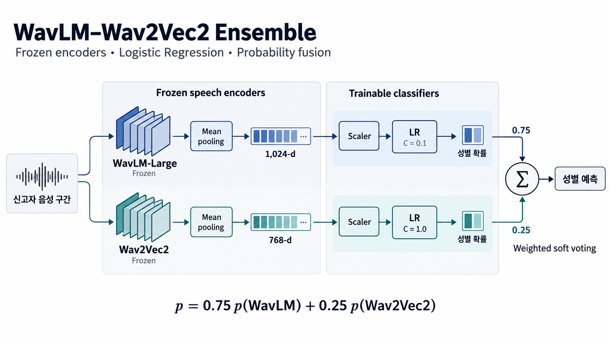

# Mission 1 진행 과정

> PPT 제작 보조자료: 본문 7페이지 유지. 각 페이지는 **질문 → 방법 선택 이유·조건 → 결과 → 판단** 순서로 구성한다. 연결 질문은 판단 문장에 통합하고, 상세 비교와 제작 메모는 부록에서 선택 사용한다.

**전체 흐름:** 신고자 입력·평가 단위 확인 → 특징별 성능과 오답 비교 → 개선 요인·오류 가설 점검 → WavLM 특징 선택 → OOF로 앙상블 비중 선택 → 교정·신규 오류 확인 → 활용 가능성과 한계

## 1페이지 | 신고자 구간과 통화 단위로 입력·평가를 구성했다

**질문 | 학습에 사용할 데이터와 평가 조건을 믿을 수 있는가?**

- 119 통화에는 신고자·상담원이 함께 등장하고, 통화마다 발화 수와 길이가 다름
- 상담원과 신고자가 함께 있는 입력에서 **정답 라벨의 신고자 구간**을 사용해 분류 대상에 맞춤
- 통화마다 다른 발화 수·길이는 고정 차원 특징으로 집계하고, **통화별 성별 하나**를 예측

**확인 조건과 결과**

- 사용 가능한 **27,985통화**를 분석 대상으로 확정
- 성별 비율을 유지해 **Train 22,388 / Internal Validation 5,597통화** 분할(seed 42)
- 통화 단위 분할 → 같은 통화의 발화가 Train·Validation에 동시에 들어가는 것을 방지
- 이후 최종 성능 비교에 동일 Internal Validation 사용; 공식 Validation 결과와 구분

**품질 점검 사례 | 반복 F0 값**

- 약 329Hz 반복값 발견 → 실제 스펙트럼·합성 신호 확인 → **660Hz 톤의 반주파수 추정** 확인
- 추정값을 사람의 실제 음높이로 단정하지 않고 F0 품질 기준에 반영

**판단**

- 파일·구간·분할을 점검한 조건에서 **F0·MFCC·사전학습 음성 특징의 성능과 오답을 비교**

---

## 2페이지 | MFCC의 보완성을 확인하고 특징·규제 효과를 나눠 비교했다

**질문 | 정확도가 낮은 특징도 보완 정보가 있는가? 개선은 어디서 오는가?**

**방법 선택과 비교 조건**

- 높낮이·기본 음향 정보, MFCC, 사전학습 표현을 비교해 **특징에 따라 성능과 오답이 어떻게 달라지는지 확인**

- 동일 Train·Internal Validation 사용; Wav2Vec2 본체 고정, 768차원 특징에 LR만 학습
- Wav2Vec2: 마지막 층의 발화별 시간 평균 → 발화를 동일 가중 평균해 통화 특징 생성

| 특징·분류기 | 사용 정보 | Internal Validation 정확도 |
|---|---|---:|
| F0 + Acoustic + LR | 높낮이·음량·유성음·길이 | 91.21% |
| MFCC + RBF SVM | MFCC 통화 특징 54차원 | 95.07% |
| Frozen Wav2Vec2 + LR | 사전학습 음성 특징 768차원 | 97.25% |

- Wav2Vec2가 MFCC 오답 **182건 교정**; **MFCC만 맞힌 60건**, 공통 오답 **94건**
- MFCC를 바로 제외하지 않고 **특징 결합**과 **LR의 C 변경**을 나눠 비교

**추가 실험 조건·결과**

- 저장 특징 재사용; Train **22,388통화**, 동일 **3-fold·8개 설정**으로 규제·결합·SVM 비교
- 각 fold의 Scaler는 해당 학습 통화에만 fit

| 주요 비교 설정 | Train CV 평균 정확도 | OOF 오답 |
|---|---:|---:|
| Wav2Vec2 + LR, C=1 | 97.097% | 650건 |
| Wav2Vec2 + LR, C=0.1 | 97.298% | 605건 |
| Wav2Vec2 + MFCC + LR, C=1 | 97.217% | 623건 |
| Wav2Vec2 + MFCC + LR, C=0.1 | **97.454%** | **570건** |

**판단**

- 특징 고정 후 C=1 → 0.1: **45건 감소** / C=0.1 고정 후 MFCC 추가: **35건 추가 감소**
- 결합 효과만으로 설명하지 않고 **규제 강도 효과도 별도 확인**
- 결합 모델의 **남은 570오답**을 길이·무음 조건으로 나눠, 전처리로 해결할 근거가 있는지 점검

> 두 표의 평가셋은 다름. OOF는 각 통화를 학습에 포함하지 않은 fold 모델의 예측이며, 결합 후보의 새 Internal Validation 평가는 수행하지 않음.

---

## 3페이지 | 짧은 음성·무음만으로 남은 오류를 설명하기 어려웠다

**질문 | 짧은 음성·무음이 남은 오류의 주요 설명이 될 수 있는가?**

**분석 조건**

- Wav2Vec2 + MFCC + LR(C=0.1)의 **Train OOF 오답 570건** 분석
- 신고자 음성 길이·발화별 평균 무음 비율·발화 수·F0 지표로 구분

| 확인한 집단 | 전체 통화 | 오답 |
|---|---:|---:|
| 신고자 음성 8초 미만 | 108건 | 4건 |
| 신고자 음성 20초 이상 + 평균 무음 비율 10% 미만 | 16,587건 | 404건 |

**결과를 보고 한 판단**

- 8초 미만 집단은 **전체 570오답 중 4건** → 짧은 음성만으로 전체 오류 설명 어려움
- 길고 무음이 적은 집단에도 **404오답** → 무음 비율만으로도 설명 어려움
- **짧은 구간 삭제·무음 제거를 해결책으로 바로 채택하지 않음**
- 길이·무음의 영향을 전면 부정한 것이 아니라, 이를 전체 오류의 설명으로 삼는 근거가 부족함을 확인
- 잡음·화자 혼입·라벨 오류는 실제 원인으로 확정하지 않음

**별도 탐색 | 다른 음성 표현의 성능 비교**

- 오류 분석에서는 전처리 방향의 근거를 점검했고, WavLM 실험에서는 **사전학습 음성 표현을 바꿨을 때의 성능**을 비교
- WavLM에서는 **마지막 층 평균과 여러 층 통계량**을 비교해 사용할 표현을 선택

---

## 4페이지 | dev 비교로 마지막 층 평균·C=0.1을 선택했다

**질문 | 다른 음성 표현이 도움이 되는가? 더 많은 층의 정보를 써야 하는가?**

**방법 선택 이유**

- 다른 사전학습 음성 표현 후보로 **WavLM-Large**를 비교하고, 본체를 고정한 특징과 LR로 성능 확인
- **6·12·18·24층:** 중간층과 상위층 정보를 함께 시험하려는 설계 의도로 등간격 4층 비교
- **평균·표준편차:** 평균 특징에 시간 변동 정보를 더하면 도움이 되는지 확인

**실험 조건**

- **WavLM-Large 본체 고정**, 신고자 음성 특징 추출 후 Logistic Regression 학습
- 마지막 층 평균 vs **6·12·18·24층의 평균·표준편차** 비교
- **Train 내부 dev 4,478통화**에서 특징 2종 × C 2종 비교; fine-tuning 미수행

| 특징 구성 | 차원 | C=0.1 정답 | C=1 정답 |
|---|---:|---:|---:|
| 마지막 층 평균 | 1,024 | **4,388건** | 4,357건 |
| 여러 층 평균·표준편차 | 8,192 | 4,385건 | 4,376건 |

**결과를 보고 한 판단**

- **마지막 층 평균 + LR(C=0.1)** 선택: 비교한 4개 설정 중 dev 정답 수 최대
- 같은 C=0.1에서 **4,388 vs 4,385건**, 차이는 **3건**; 선택된 특징 차원은 8분의 1
- 선택 기준은 **관측된 dev 정답 수**이며, 작은 차이만으로 통계적 우위나 동등성을 판단하지 않음
- C=1에서는 여러 층 특징이 더 높음 → 특징 차원만으로 성능을 예측하기 어려움

**선택 후 검증**

- 설정 확정 → 전체 Train으로 LR 재학습 → **별도의 Internal Validation** 평가
- Internal Validation에서 **98.09%·107오답** 확인; Wav2Vec2만 맞힌 **35건**도 잔존
- 단독 정확도뿐 아니라 **Wav2Vec2가 보완할 수 있는 오답**에 주목해 확률 결합을 검토

---

## 5페이지 | 두 음성 모델의 확률을 75:25로 결합했다

**질문 | 두 모델을 얼마나 섞어야 WavLM 단독보다 나아지는가?**

**최종 모델 | WavLM-Large + Wav2Vec2 확률 앙상블**

- **입력·전처리:** 8kHz 신고자 구간을 16kHz로 변환해 각 음성 모델에 입력
- **WavLM:** 신고자 구간 연결 → 최대 12초 창 → 마지막 층 평균을 실제 샘플 수로 가중 집계 → **1,024차원 → Scaler → LR(C=0.1)**
- **Wav2Vec2:** 발화별 최대 15초 분할 → 프레임 수 가중 평균 → 발화 동일 가중 평균 → **768차원 → Scaler → LR(C=1.0)**
- **전처리와 모델의 연결:** 서로 다른 길이의 신고자 음성을 고정 차원 통화 특징으로 집계해 LR에 입력. 창·발화 집계 방식도 달라 성능 차이 전체를 모델 본체의 효과로 해석하지 않음
- **출력:** `WavLM 성별 확률 × 0.75 + Wav2Vec2 성별 확률 × 0.25`에서 높은 성별 선택
- **학습 범위:** 두 음성 모델은 고정; 저장 특징으로 Scaler·LR 학습. 음성 모델 fine-tuning 미수행
- **결합 이유:** WavLM이 틀리고 Wav2Vec2가 맞힌 사례의 보완 가능성을 검증

**비중 선택 조건**

- Train **22,388통화**, 성별 비율을 유지한 **3-fold(seed 42)**에서 OOF 확률 생성
- 각 fold의 Scaler·LR은 해당 학습 통화에만 fit; 특징 구성·LR의 C는 위 설정으로 고정

**선택 기준과 결과**

- WavLM 비중 **75% / 50%** 두 후보 비교
- 채택 조건: WavLM 단독 대비 **3개 fold 모두 하락 없음 + 전체 OOF 정확도 0.1%p 이상 개선**
- 조건 미달 시 WavLM 단독 유지; 동률이면 WavLM 비중이 높은 후보 우선

| WavLM : Wav2Vec2 | Train OOF 정확도 | 채택 조건 확인 |
|---|---:|---|
| 100 : 0 | 98.052528% | 기준 모델 |
| **75 : 25** | **98.173128%** | **세 fold 모두 개선, 전체 +0.120600%p → 채택** |
| 50 : 50 | 98.128462% | Fold 1 하락 → 제외 |

**결과를 보고 한 판단**

- 50:50은 전체 OOF 정확도가 올랐지만 **Fold 1에서 하락** → 사전 채택 조건 미충족
- 75:25는 **모든 fold에서 개선**, 전체 **+0.120600%p** → 채택 조건 충족
- 전체 OOF 수치만 보지 않고, **분할마다 개선이 유지되는지도 선택 기준에 반영**

**선택 후 검증**

- **비중 75:25 고정 → 전체 Train으로 LR 재학습 → Internal Validation 평가**
- 최종 검증 점수를 보고 비중을 다시 조정하지 않음

> Train OOF는 비중 선택용이며 독립 test가 아님. 채택 기준은 보수적인 선택 규칙으로, 통계적 유의성 검정은 아님.

---

## 6페이지 | WavLM과 앙상블의 개선을 교정·신규 오류로 확인했다

**질문 | 각 단계에서 얼마나 개선됐고, 어떤 오류가 남았는가?**

**공통 평가 조건**

- 정답 신고자 구간, 동일 **Internal Validation 5,597통화**
- WavLM: 마지막 층 평균 + LR(C=0.1); Wav2Vec2: LR(C=1.0)
- 두 음성 모델 본체 고정, **fine-tuning 미수행**; 특징·C·결합 비중을 Train에서 선택 후 고정
- 앙상블: **WavLM 확률 × 0.75 + Wav2Vec2 확률 × 0.25**

| 모델 | 정확도 | 정답 | 오답 |
|---|---:|---:|---:|
| Frozen Wav2Vec2 + LR | 97.25% | 5,443건 | 154건 |
| Frozen WavLM-Large + LR | 98.088262% | 5,490건 | 107건 |
| **WavLM 75% + Wav2Vec2 25%** | **98.213329%** | **5,497건** | **100건** |

**전체 오답 변화 | 154건 → 107건 → 100건**

**① Wav2Vec2 → WavLM: 오답 47건 감소**

- 기존 오답 154건 중 **82건을 고침** → 72건은 여전히 오답
- 기존에 맞혔던 통화 **35건을 새로 틀림**
- **154 − 82 + 35 = 107건**: 정확도 +0.84%p, 오답 약 30.5% 감소

**② WavLM → 앙상블: 오답 7건 추가 감소**

- WavLM의 전체 오답 **107건에서 다시 비교**
- 그중 **11건을 고침** → 96건은 여전히 오답
- 기존에 맞혔던 통화 **4건을 새로 틀림**
- **107 − 11 + 4 = 100건**: 정확도 +0.125067%p, 오답 약 6.54% 감소

**결과 해석**

- 각 단계의 **전체 오답 수**를 기준으로 개선을 비교
- 고친 오답뿐 아니라 새로 생긴 오답도 반영해 실제 감소량 확인

**과정에서 확인한 점**

- **보완성 확인**: MFCC만 맞힌 60건 → 특징 결합; Wav2Vec2만 맞힌 35건 → 확률 결합 질문
- **개선 요인 분리**: C 변경 45건·MFCC 추가 35건 감소를 구분
- **채택 기준 적용**: WavLM은 dev 정답 수, 앙상블은 전체 OOF·fold별 조건으로 선택

---

## 7페이지 | 보완 정보의 효과와 남은 오류를 함께 고려했다

**질문 | 우리 모델의 개선은 119 통화 분석에 어떤 의미가 있는가?**

**실험에서 얻은 인사이트**

- **정확도 순위만으로 특징을 제외하지 않음:** MFCC만 맞힌 60건에서 보완 가능성 확인
- **개선 원인을 분리:** C 변경과 특징 추가를 같은 효과로 해석하지 않음
- **설정은 비교 결과로 선택:** 고차원 특징이 항상 우수하지 않았고, 앙상블은 fold별 채택 조건까지 확인

**사회안전 활용 가능성**

- 신고자 성별 예측을 **119 통화 분석의 보조 정보**로 제공하는 활용 검토
- 상담원이 확인한 정보와 함께 참고하는 형태를 고려하며, 실제 업무 효과는 아직 검증하지 않음

**우리 모델에서 확인한 근거**

| 실험에서 확인한 특징 | 사회안전 관점의 의미 |
|---|---|
| WavLM 중심에 Wav2Vec2 확률 결합 → 오답 **107 → 100건** | 단일 모델이 놓친 사례를 다른 모델의 보완 정보로 줄일 가능성 |
| 50:50은 한 fold 하락으로 제외, 75:25는 **세 fold 모두 개선** | 평균 성능뿐 아니라 분할별 개선의 일관성도 고려한 선택 |
| 기존 오답 **11건 교정**, 기존 정답 **4건 신규 오분류** | 성능 향상과 함께 새로 발생하는 오류도 점검하는 평가 방식 |

**적용 시 판단**

- 성별 예측은 **확정 정보가 아닌 보조 추정값**으로 취급
- 현재는 정답 신고자 구간을 사용 → 실제 활용에는 **신고자 구간 자동 추출과 새로운 통화 데이터 검증** 필요
- 이번에 확인한 것은 내부 검증의 분류 성능 개선이며, 출동 속도·구조 성과·현장 안전성 향상을 입증한 것은 아님

**핵심 시사점**

- **서로 다른 모델의 보완성을 활용하고, 교정·신규 오류를 함께 확인하면서 신고자 보조 정보의 정확도를 높일 가능성을 탐색**

---

## 부록 | 상세 비교·근거와 제작 메모

본문 7페이지에 모두 넣을 필요는 없다. 상세 확인이나 추가 슬라이드 제작에 사용한다.

### A. 앙상블의 fold별 변화

| WavLM : Wav2Vec2 | Train OOF 정확도 | Fold 1 변화 | Fold 2 변화 | Fold 3 변화 | 선택 |
|---|---:|---:|---:|---:|---|
| 100 : 0 | 98.052528% | 기준 | 기준 | 기준 | 기준 모델 |
| **75 : 25** | **98.173128%** | +0.080397%p | +0.200992%p | +0.080407%p | **채택** |
| 50 : 50 | 98.128462% | -0.066997%p | +0.254589%p | +0.040204%p | 제외 |

### B. 모델 구성도 · 선택 사용

```text
정답 신고자 음성 구간
  ├─ WavLM-Large → 마지막 층 평균 1,024차원 → Scaler → LR(C=0.1) → 성별 확률
  └─ Wav2Vec2   → 통화 특징 768차원         → Scaler → LR(C=1.0) → 성별 확률
                                   ↓
                 WavLM 확률 × 0.75 + Wav2Vec2 확률 × 0.25
                                   ↓
                        결합 확률이 높은 성별을 예측
```

- **음성 모델:** 신고자 음성을 분류용 수치 특징으로 변환; 두 본체는 고정
- **Scaler·LR:** 특징을 표준화한 뒤 성별 확률 산출; Train으로 Scaler를 fit하고 LR 학습
- **결합 목적:** WavLM이 틀렸지만 Wav2Vec2가 맞힌 사례를 보완할 수 있는지 검증
- **학습 범위:** 음성 모델 fine-tuning 없이 기존 특징 재사용

**참고 이미지 · 선택 사용**

> PPT 제작 시 필요하면 사용할 수 있는 모델 구성 참고 이미지. 위 텍스트 구성도와 함께 검토하고, 최종 슬라이드에는 적합한 형식을 선택.



### C. 결과 신뢰도와 해석 범위

- **Train 내부 dev:** WavLM 특징·C 선택용 4,478통화.
- **Train 3-fold OOF:** 분류기·특징 비교 또는 앙상블 비중 선택용. 각 통화는 해당 통화를 학습하지 않은 fold 모델로 예측.
- **Internal Validation:** 선택을 고정한 뒤 동일 5,597통화로 비교. 공식 Validation이나 새 독립 test 결과와 구분.
- 현재 근거로 사용한 seed 42의 3-fold는 **서로 다른 시드의 반복 실험이 아님**. 여러 시드 평균 ± 표준편차를 새로 만들지 않는다.
- 통계 검정 결과는 이번 자료에 추가하지 않음. fold별 개선과 오답 감소율을 통계적 유의성으로 표현하지 않는다.
- 마지막 층의 3건 우위를 통계적 우위·동등성으로 해석하지 않는다. 선택 규칙은 dev 정답 수 최대, 동률이면 마지막 층 평균 → 작은 C 순이다.
- 등간격 4층은 중간·상위 정보를 함께 시험하려는 **설계 의도**이며, 각 층의 정보 역할을 이번 실험으로 입증한 것은 아니다.
- 오류 분석이 WavLM 선택의 직접 계기였다는 기록은 확인되지 않음. 두 활동은 별도 탐색으로 연결한다.

### D. 근거 자료

- [데이터 점검](eda/REPORT.md), [통화 단위 분할](validation/REPORT.md)
- [분류기·특징 결합 실험](experiments/embedding_classifiers/A1_REPORT.md)
- [WavLM 특징·레이어 선택 설계](experiments/wavlm_gender_adaptation/README.md)
- [WavLM 내부 검증 결과](experiments/wavlm_gender_adaptation/results/2026-10-07/REPORT.md)

- [실험 조건과 선택 규칙](experiments/wavlm_wav2vec2_ensemble/README.md)
- [2026-10-09 공유 결과와 검증 범위](experiments/wavlm_wav2vec2_ensemble/results/2026-10-09/README.md)
- [Train OOF 선택 기록](experiments/wavlm_wav2vec2_ensemble/results/2026-10-09/selection.lock.json)
